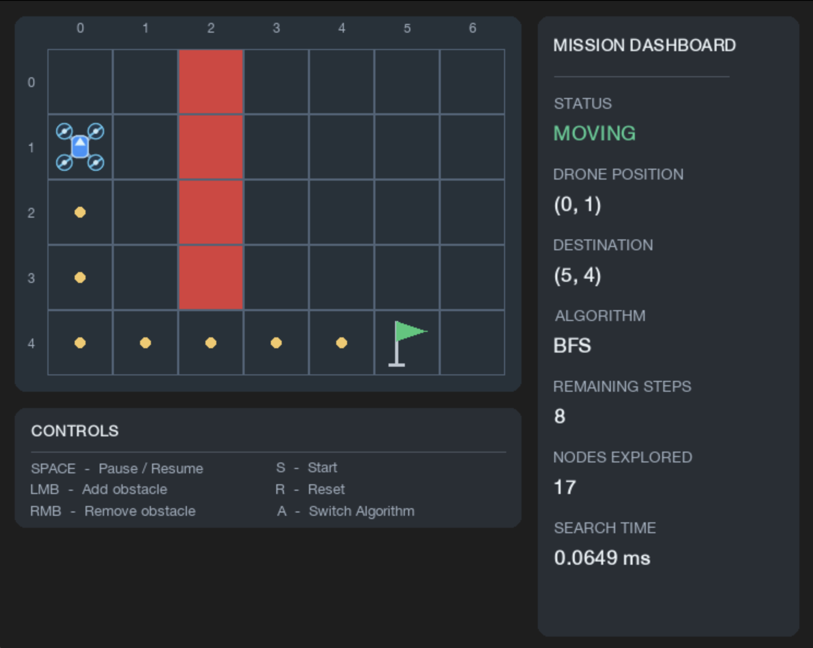

# Autonomous Drone Mission Simulator

A Python-based, interactive 2D autonomous drone mission simulator featuring BFS and A* search algorithm pathfinding, dynamic obstacle avoidance, mission state management, and real-time performance monitoring.

Built with Python and Pygame to explore autonomous navigation algorithms, modular software architecture, and event-driven simulation.

## Features

- **Autonomous Pathfinding:** BFS and A* algorithms for shortest-path navigation on a 2D grid.
- **Dynamic Obstacle Replanning:** Automatically recalculates routes when obstacles interfere with the drone's current path.
- **Interactive Environment:** Add or remove obstacles using mouse controls.
- **Mission State Management:** Supports IDLE, MOVING, PAUSED, COMPLETED, and FAILED states.
- **Algorithm Switching:** Switch between BFS and A* to compare navigation behavior.
- **Performance Monitoring:** Displays nodes explored and pathfinding execution time.
- **Graphical Interface:** Custom drone visualization, destination markers, coordinate labels, and a live mission dashboard.
- **Automated Tests:** Validates pathfinding behavior across multiple navigation scenarios.

## Technologies

- Python
- Pygame
- Graph algorithms (BFS and A*)
- Priority queues (`heapq`)
- Object-oriented programming
- Git and GitHub

## Project Architecture

```text
autonomous-drone-mission-simulator/
├── drone.py
├── environment.py
├── mission_controller.py
├── pathfinding.py
├── visualization.py
├── test_pathfinding.py
├── requirements.txt
└── README.md
```

**Module responsibilities:**

| File | Description |
|---|---|
| `drone.py` | Manages the drone's position and movement |
| `environment.py` | Manages grid boundaries, obstacles, and valid movement |
| `pathfinding.py` | Implements BFS, A*, and Manhattan distance |
| `mission_controller.py` | Coordinates mission execution, state transitions, and replanning |
| `visualization.py` | Implements the Pygame interface, rendering, and user input |
| `test_pathfinding.py` | Tests shortest paths, obstacle handling, and unreachable destinations |

## Installation

**1. Clone the repository**

```bash
git clone https://github.com/YOUR-USERNAME/autonomous-drone-mission-simulator.git
cd autonomous-drone-mission-simulator
```

Replace `YOUR-USERNAME` with your GitHub username.

**2. Install dependencies**

Python 3 and pip are required.

```bash
python -m pip install -r requirements.txt
```

**3. Run the simulator**

```bash
python visualization.py
```

## Controls

| Control | Action |
|---|---|
| `S` | Start mission |
| `SPACE` | Pause or resume |
| `R` | Reset mission |
| `A` | Switch between BFS and A* while idle |
| Left mouse button | Add obstacle |
| Right mouse button | Remove obstacle |

## Pathfinding Algorithms

### Breadth-First Search (BFS) Algorithm

BFS uses a FIFO queue to systematically explore neighboring cells. Because every movement has equal cost, BFS guarantees a shortest path when one exists.

### A* Search Algorithm

A* uses a priority queue and the Manhattan distance heuristic to guide exploration toward the destination.

The evaluation function is:

**f(n) = g(n) + h(n)**

Where:

- `g(n)` is the known cost from the starting position.
- `h(n)` is the estimated remaining cost to the goal.
- `f(n)` is the estimated total cost through that position.

Both algorithms support four-directional navigation and avoid blocked cells.

## Performance Comparison

Results from an example 7 × 5 grid with obstacles:

| Metric | BFS | A* |
|---|---:|---:|
| Nodes explored | 17 | 14 |
| Shortest path length | 9 moves | 9 moves |
| Search time | 0.1823 ms | 0.2307 ms |

In this scenario, A* explored approximately **17.6% fewer nodes** than BFS while producing an equally short route.

Although A* expanded fewer nodes, BFS completed the search faster in this individual measurement. Runtime varies with grid configuration, heuristic overhead, and execution conditions. The timing results are illustrative rather than a statistically significant benchmark.

## Testing

Run the pathfinding tests:

```bash
python test_pathfinding.py
```

The test suite checks:

- Navigation around obstacles
- Identical starting and destination positions
- Shortest paths in an empty environment
- Unreachable destinations

Both algorithms are checked for valid movement, correct endpoints, and expected path lengths.

## Screenshots



## Future Improvements

- Larger and configurable environments
- Additional pathfinding algorithms
- More comprehensive automated testing
- Pathfinding exploration visualizations
- Expanded performance benchmarking

## Project Scope

This project is a software-based 2D navigation simulator. It demonstrates path planning, obstacle-aware route recalculation, algorithm comparison, and mission control logic. It does not implement physical drone flight control or real-world sensor-based obstacle detection.
